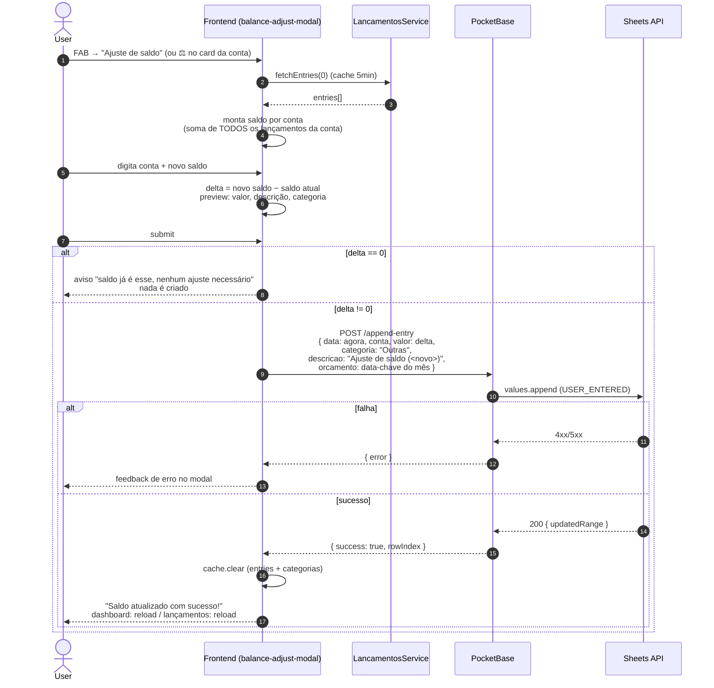

# PRD-013 — Ajuste de Saldo da Conta (Reconciliação)

## Contexto

O saldo de uma conta no app **não é um campo**: é a **soma de todos os
lançamentos** da conta na planilha do usuário. Isso é ótimo pra quem
registra tudo, mas quebra pra quem tem conta que **não existe no app** —
cartão de crédito usado fora do app, conta corrente de um banco que o
usuário nunca lança, dinheiro em espécie que o app só enxerga por
lançamentos parciais.

Nesses casos o usuário precisa **corrigir a realidade**: o banco diz que a
conta tem -4000, mas o app mostra -3200 porque faltam lançamentos. A
alternativa hoje seria criar um lançamento "mágico" na mão, com valor,
categoria e data escolhidos pelo usuário — e o app ainda mostrava o valor
errado porque ele somaria todos os lançamentos, sem noção de "estado
desejado".

O ajuste de saldo inverte a lógica: o usuário informa **qual é o saldo
verdadeiro** e o app calcula o **delta** (a diferença) e cria o lançamento
de correção automaticamente. A partir daí, o app volta a mostrar o saldo
que o usuário digitou.

Exemplo: saldo no app = -3200, saldo real = -4000 → cria lançamento de
**-800** com data/hora atual, categoria `Outras`, descrição
`Ajuste de saldo (-4000)`.

## Objetivos

- Permitir corrigir o saldo de uma conta informando o **novo saldo**, não
  o valor do lançamento
- Calcular o delta automaticamente (`novo saldo − saldo atual`) e mostrar
  **preview** antes de salvar (valor, descrição, categoria)
- Registrar o ajuste como lançamento normal, com **data/hora do momento**
  do ajuste e **data-chave do mês corrente**
- Expor o form nas **duas páginas** do dashboard web (Dashboard e
  Lançamentos) e dar **atalho direto por conta** no card de saldo
- Manter a conta sempre visível no lançamento criado (a coluna "conta" é
  preenchida com a conta ajustada)

## Não-objetivos

- **Conciliação automática** com extrato bancário / Open Finance — fora
- **Histórico de saldos** (saldos em datas passadas) — fora; o ajuste
  sempre usa a data/hora atual
- **Estorno automático** do ajuste — fora; se o usuário errar o novo
  saldo, ele apaga o lançamento pelo fluxo normal (PRD-003)
- **Ajuste em lote** (várias contas de uma vez) — fora
- **Ajuste no PWA** (celular) — fora por enquanto; só o dashboard web
  tem o form
- **Substituir a categoria `Saldo`** (tipo `SALDO`, PRD-006) — o ajuste
  usa a categoria `Outras` (ver Notas / Pendências)

## Personas

- **Usuário autenticado com planilha** — reconcilia o saldo de uma conta
  que o app não reflete fielmente (cartão usado fora do app, conta de
  banco sem lançamentos, dinheiro em espécie)

## User Stories

### US-13.1 — Abrir o form de ajuste

**Como** usuário autenticado,
**quero** abrir um form específico de ajuste de saldo,
**para** corrigir o saldo de uma conta sem precisar calcular o valor do
lançamento na mão.

**Critérios de aceite:**
- [ ] Opção "⚖️ Ajuste de saldo" no menu do FAB, tanto no **Dashboard**
      quanto na página de **Lançamentos**
- [ ] A opção aparece **acima** de "Transferência" no menu
- [ ] Clicar no card de uma conta na seção "Saldo e contas" (dashboard)
      abre o **mesmo form** já com a conta preenchida
- [ ] O form tem 3 campos: **Conta** (input com autocomplete de contas já
      usadas), **Saldo atual** (somente leitura) e **Novo saldo** (número,
      aceita negativo)
- [ ] "Saldo atual" é preenchido automaticamente a partir da conta
      escolhida e atualiza em tempo real

### US-13.2 — Criar o ajuste

**Como** usuário,
**quero** informar o novo saldo de uma conta,
**para** o app criar o lançamento de correção e passar a mostrar o saldo
real.

**Critérios de aceite:**
- [ ] O usuário informa o **novo saldo** (não o valor do lançamento)
- [ ] Delta = `novo saldo − saldo atual`, arredondado a 2 casas
- [ ] Preview mostra, antes de salvar: saldo atual, novo saldo, **valor do
      lançamento**, **descrição** e **categoria**
- [ ] Lançamento criado com:
  - `data` = data/hora atual no formato `DD/MM/YYYY HH:mm`
  - `conta` = conta ajustada
  - `valor` = delta (negativo reduz o saldo, positivo aumenta)
  - `categoria` = `Outras`
  - `descricao` = `Ajuste de saldo (<novo saldo>)` — ex.: `Ajuste de saldo (-4000)`
  - `orcamento` = data-chave do mês corrente (usa a data-chave já
    existente no mês; se não houver nenhuma, dia 1 do mês)
- [ ] Salvar usa `POST /append-entry` (sem endpoint novo)
- [ ] Cache de lançamentos/categorias invalidado após o sucesso
- [ ] Dashboard recarrega a página; Lançamentos recarrega a lista
- [ ] Se o delta for **zero** (novo saldo = saldo atual), **nada é criado**
      e o usuário recebe aviso

### US-13.3 — Reconciliar sem poluir os gráficos de gasto

**Como** usuário,
**quero** que o saldo da conta após o ajuste seja exatamente o que digitei,
**para** confiar no número que aparece no dashboard.

**Critérios de aceite:**
- [ ] O saldo usado de referência é o **mesmo exibido no dashboard**: soma
      de **todos** os lançamentos da conta (inclusive os futuros, que
      entram com o valor mas sem data)
- [ ] Depois do ajuste, `saldo atual + delta` = novo saldo informado
- [ ] A conta continua visível no card "Saldo e contas" com o valor novo

## Fluxo de uso

### Ajustar saldo
```
User no dashboard ou lançamentos → FAB → "Ajuste de saldo"
  → modal abre
  → campo "Conta" (input com autocomplete; focar lista as contas)
  → user digita/seleciona a conta
  → "Saldo atual" preenche sozinho com o saldo que o app mostra
  → user digita o "Novo saldo" (ex.: -4000)
  → preview mostra: saldo atual, novo saldo, valor do lançamento,
     descrição e categoria
  → submit
  → POST /append-entry { valor: delta, categoria: "Outras",
                         descricao: "Ajuste de saldo (-4000)", ... }
  → sucesso: cache invalidado, dashboard recarrega (ou lista recarrega)
  → toast/feedback "Saldo atualizado com sucesso!"
```

### Atalho pelo card da conta (dashboard)
```
User no dashboard → seção "Saldo e contas" → clica ⚖️ no card da conta
  → mesmo modal abre com a conta preenchida
  → (o clique no ⚖️ não alterna incluir/excluir a conta do saldo total)
```

### Cancelar
```
User abre modal e fecha sem submit
  → nada acontece, sem confirmação (mudanças não persistem)
```

## Diagrama de sequência



**Atores:** User, Frontend, LancamentosService, PocketBase, Sheets API.

**Highlights:**
- **Não há endpoint novo** — reusa `POST /append-entry`
- O **delta é calculado no frontend**, a partir dos lançamentos em cache
- A base do saldo é a **soma de todos os lançamentos da conta** (futuros
  inclusos) — a mesma do card de conta do dashboard
- O lançamento usa a **categoria `Outras`** e a **data/hora atual**

## Edge cases

- **Delta zero** (novo saldo = saldo atual): o submit é bloqueado com
  aviso; nenhum lançamento é criado (evita linha inútil na planilha)
- **Conta digitada que não existe nos lançamentos**: o saldo atual é
  tratado como R$ 0,00 e o preview avisa "Conta sem lançamentos no app"
- **Caixa diferente** (`nubank` vs `NUBANK`): a busca do saldo tem
  fallback case-insensitive
- **Conta em branco**: o navegador bloqueia o submit (campo obrigatório)
- **Novo saldo em branco ou não numérico**: submit bloqueado com aviso
- **Cache stale (5 min)**: o "saldo atual" exibido é o do cache; se o
  usuário lançou coisas em outro device, o delta fica levemente errado —
  Accepted (mesma política de cache do resto do app). O botão
  "🔄 Atualizar" do dashboard resolve
- **Lançamento futuro sem data**: entra na soma do saldo da conta (o
  dashboard também soma) — o ajuste compensa essa diferença junto com as
  demais
- **Erro no `/append-entry`**: nada é criado; o erro aparece no feedback
  do modal e o form continua preenchido para nova tentativa
- **Ajuste errado (usuário errou o novo saldo)**: não há estorno
  automático — o usuário apaga o lançamento pelo fluxo normal (PRD-003)
- **Ajustes repetidos na mesma conta**: cada um é um lançamento
  independente; o saldo final é a soma de todos

## Requisitos técnicos

- **Frontend**: novo componente `src/components/balance-adjust-modal.ts`
  (`initBalanceAdjustModal` / `openBalanceAdjustModal(conta?)`)
- **Sem endpoint novo** — reusa `POST /append-entry` via
  `SheetsService.appendEntry()` (que já invalida o cache)
- **Integração**:
  - `src/dashboard/dashboard.ts` — init do modal + 4ª opção do FAB +
    listener do evento `balance:adjust` (recarrega a página no sucesso)
  - `src/dashboard/lancamentos.ts` — init do modal + 4ª opção do FAB
    (recarrega a lista no sucesso)
  - `src/components/fab-menu.ts` — nova opção do menu (com nome fixo
    "Ajuste de saldo")
  - `src/components/details.ts` — botão ⚖️ no card de conta (evento
    `balance:adjust`)
- **Categoria**: constante `CATEGORIA_AJUSTE = 'Outras'` no componente
  (categoria padrão da planilha, `provision-sheet.pb.js`)
- **Data-chave do orçamento**: reusa a data-chave já usada no mês
  corrente; se não houver nenhuma, dia 1 do mês
- **CSS**: `src/css/components/entry-modal.css` (preview do lançamento) e
  `src/css/components/details.css` (botão ⚖️ no card de conta)
- **PWA**: **não implementado** — o form existe só no dashboard web

## Métricas de sucesso

- **Volume de ajustes/usuário/mês** — baseline a definir
- **Taxa de erro na criação** — % de ajustes que falham no
  `/append-entry` (meta: <3%)
- **Proporção de ajustes** sobre o total de lançamentos — proxy de uso
  real da feature

## Notas / Pendências

- **Categoria `Outras` vs `Saldo`**: a planilha tem a categoria `Saldo`
  (tipo `SALDO`, PRD-006), criada exatamente para "saldo inicial ou
  correção de saldo". Hoje o ajuste usa `Outras` (tipo `QUERO`), então um
  ajuste **negativo aparece como despesa** no gráfico "Gastos por Tipo" e
  no Top 10 de gastos por categoria. Migrar para `Saldo` resolve isso —
  é uma constante (`CATEGORIA_AJUSTE`) no componente.
- **Sem data retroativa**: o ajuste sempre usa agora. Para corrigir um
  saldo de mês passado, o usuário teria que editar a data do lançamento
  depois (ou criar o lançamento manualmente).
- **Sem conciliação**: o usuário precisa saber o saldo real por fora
  (app do banco). Um futuro "importar saldo" do Open Finance resolveria
  o caso de uso raiz.
- **PWA sem suporte**: no celular ainda é preciso criar o lançamento pelo
  form de receita/despesa ou pelo dashboard web.
- **Sem estorno**: ajuste errado exige apagar o lançamento manualmente.
